<p align="center">
  
</p>

<p align="center">
  <a href="https://github.com/Hainrixz/traxo-agente/actions/workflows/ci.yml"></a>
  <a href="LICENSE"></a>
  
  
  
</p>

<p align="center">
  <a href="README.md">English</a> · <b>Español</b> ·
  <a href="#instálalo-con-un-asistente-2-comandos-y-una-conversación">Instalar</a> ·
  <a href="#qué-hay-en-el-panel">Panel</a> ·
  <a href="#en-la-nube-railway--postgres">Railway</a> ·
  <a href="CONTRIBUTING.md">Contribuir</a>
</p>

## Acerca de Traxo

<p align="center">
  
</p>

Traxo es un agente **open source** que opera tu e-commerce desde Claude. Hoy soporta **Colombia** (el primer mercado) y está pensado para crecer a más países: mira [`docs/mercados.md`](docs/mercados.md). Cuando entra un pedido cotiza entre transportadoras, elige la mejor (y te explica por qué), confirma por WhatsApp las contraentregas de riesgo, genera la guía, la escribe en tu tienda, vigila el envío y atiende las novedades. También audita tu tienda, arma anuncios con tus propios videos UGC y fotos de producto, te dice qué anuncio trajo qué venta, cuida a tus clientes con su consentimiento y te muestra cuánto trabajó el agente y cuánto costó. **Todo lo que pasa en tu negocio queda en un solo lugar, y tiene un agente al que le puedes preguntar.**

- **Es tuyo:** corre en tu computador o en tu Railway. Tus datos y tus llaves no salen de tu servidor.
- **Es honesto:** lo que no se puede medir sale como `N/A`; lo que gasta, publica o borra espera tu sí; las campañas nacen en pausa.
- **Es global por diseño:** Colombia primero, y cualquiera puede [sumar su país](docs/mercados.md).
- **Es para la comunidad:** MIT, sin cuentas ni servicios propios que pagar. [Contribuye](CONTRIBUTING.md), abre un issue o cuéntanos cómo lo usas.

## Instálalo con un asistente (2 comandos y una conversación)

Necesitas [Claude Code](https://claude.com/claude-code), [Node 24](https://nodejs.org) y [git](https://git-scm.com). El resto lo hace el asistente.

```bash
claude plugin marketplace add Hainrixz/traxo-agente
claude plugin install traxo@traxo
```

Abre `claude` y escribe:

```
/traxo:instalar
```

El asistente te **hace las preguntas** y se encarga de todo, paso a paso, verificando cada uno:

1. Clona el proyecto, instala dependencias y compila el panel.
2. Te pregunta **dónde quieres correrlo** (en tu computador o en Railway), **qué plataforma usa tu tienda** (Shopify, Tiendanube, WooCommerce), **con qué envías**, tu correo de acceso, tu dirección de despacho y **qué más activar** (WhatsApp/Instagram/Messenger con Zernio, cobro previo con Wompi, IA con tu llave de Claude).
3. Crea tu archivo `.env` con lo que no es secreto, **genera por ti** los secretos propios (sesiones, token de `/mcp`, contraseña de administrador) y te dice **dónde conseguir cada llave** de terceros. **Tú las pegas en el `.env`: nunca pasan por el chat ni las ve el modelo.**
4. Corre `pnpm doctor`, que revisa todo (✓ / ✗ / –) y prueba las conexiones sin mostrar ningún valor.
5. Lo arranca en local, o lo sube a Railway (proyecto, Postgres, variables, volumen y dominio) con tu confirmación.
6. Te da las direcciones de **webhook** para tu tienda, Envia.com, Zernio y Wompi, conecta Claude con las herramientas de Traxo y te deja con el primer día listo.

Si algo falla, el asistente lo explica y lo arregla antes de seguir. Puedes volver a correr `/traxo:instalar` cuando quieras: no pisa lo que ya configuraste.

<details>
<summary>Instalación manual (sin el asistente)</summary>

```bash
git clone https://github.com/Hainrixz/traxo-agente.git && cd traxo-agente
corepack enable && pnpm install
pnpm build
node scripts/setup.mjs --answers '{"adminEmail":"tu@correo.co","platform":"shopify","storeDomain":"tutienda.myshopify.com","envia":true}'
# abre .env y pega tus llaves (la lista de pendientes sale en el comando anterior)
pnpm doctor           # revisa que todo esté bien
pnpm start            # http://localhost:8787  (entra con el correo y la contraseña de tu .env)
claude mcp add --scope user traxo -- pnpm --silent --dir "$PWD" exec tsx apps/worker/src/mcp-stdio.ts
```

`node scripts/setup.mjs` (o `pnpm configurar`) y `pnpm doctor` no imprimen nunca el valor de una variable. Las plantillas de todas las variables están en [`.env.example`](.env.example).
</details>

## Qué hay en el panel

El menú de la izquierda tiene lo que usas a diario. Lo que se configura vive en **tu perfil** (abajo a la izquierda): ajustes, límites de autonomía, conexiones, tema y cerrar sesión.

| Sección | Qué hace |
|---|---|
| **Inicio** | Cómo va el día, dónde está cada pedido y lo que el agente hizo hoy |
| **Agente** | Un chat con tu negocio: «¿cuánto vendí esta semana?», «¿qué anuncio funciona y cuál no?», «¿dónde está el #1186?». Responde con tus datos reales, con las fuentes, y no inventa cifras (un dato que falta sale como N/A) |
| **Pedidos** | Cada pedido con su recorrido, cómo se eligió la transportadora (costo con recaudo, días, confiabilidad) y la línea de tiempo de la guía |
| **Envíos** | Comparador de transportadoras con tus propios envíos, recogidas y cancelación |
| **Aprobaciones** | Lo que el agente no decide solo: dirección dudosa, guía por encima del tope, contraentrega sin respuesta |
| **Mensajes** | Bandeja tipo chat con contactos: **WhatsApp, Instagram y Messenger** en un solo lugar, con filtro por canal, búsqueda y ficha del cliente |
| **Clientes** | Segmentos (recompra, nuevos, inactivos), audiencias, mensajes con consentimiento, baja con «BAJA», exportar o borrar datos (Ley 1581) |
| **Marketing** | Campañas con ROAS real, creativos, **biblioteca de tus videos UGC y fotos de producto**, asistente de campañas (copy dentro de los límites de cada plataforma) y qué empujar según margen |
| **Tienda y SEO** | Auditoría de SEO, visibilidad en IA y diseño. El puntaje se calcula **sobre los checks que se pudieron medir** (los N/A no cuentan) |
| **Reportes** | Ventas, qué anuncio trajo qué venta, logística por transportadora y recaudo |
| **Constructor** | Diseña tu tienda: genera un **tema de Shopify** (Online Store 2.0, en español, accesible) con tu catálogo real, vista previa en computador y celular, descarga en .zip y flujo hacia GitHub privado y Shopify **sin publicar** |
| **Uso agéntico** | Cuánto trabajó el agente (acciones, horas de trabajo manual evitadas, estimadas), cuánto costó (IA y créditos) y por canal de mensajes; con presupuesto opcional |
| **Más → Actividad y Conexiones** | Todo lo que hace el agente, en orden, y qué está conectado (tienda, transportadoras, Zernio, anuncios) |

## Cómo funciona el seguimiento

1. **Entra un pedido**. Traxo valida la dirección (DANE), puntúa el riesgo de la contraentrega y cotiza en todas las vías a la vez.
2. **Elige y explica**: la transportadora con mejor costo total (flete + comisión de recaudo), tiempo y confiabilidad. Si el riesgo es alto, **antes de gastar en una guía** le escribe al cliente: confirma, paga ahora con descuento o cambia la dirección. Sin respuesta en 24 h te lo pasa a ti.
3. **Genera la guía** (si está dentro de tu tope) y la escribe en Shopify, Tiendanube o WooCommerce.
4. **Vigila cada guía**: recibe los eventos de la transportadora (webhook o consulta periódica), actualiza la línea de tiempo y avisa al cliente «llega hoy, ten $ X listos».
5. **Atiende las novedades**: si la entrega falla, le escribe al cliente por su canal; «Sí, mañana estoy» reprograma sola, una dirección nueva te llega a Aprobaciones.
6. **Todo queda registrado**: Actividad (lo que hizo el agente), Mensajes (lo que se dijo) y Pedidos (el recorrido). El **Agente** del panel te lo resume cuando preguntes.

## Anuncios con tus propios videos UGC y fotos

En **Marketing → Biblioteca** subes tus videos UGC y fotos de producto (arrastrando archivos; jpg, png, mp4, mov, hasta 60 MB) o los traes de Higgsfield. Al armar una campaña eliges de la biblioteca: **no cuesta créditos**. Si falta algo, Traxo propone el prompt y el costo en créditos, y **no genera nada hasta que lo confirmes**. Las campañas siempre nacen en borrador o en pausa.

Desde Claude, la skill `/traxo:campana` mira primero tu biblioteca (`listar_biblioteca`), usa lo que ya tienes como referencia y registra lo que se genere (`agregar_a_biblioteca`). Tus archivos viven en tu servidor y no se publican en ninguna plataforma sin tu aprobación.

## Mensajería y anuncios con un solo conector: Zernio

[Zernio](https://zernio.com) conecta WhatsApp, Instagram, Messenger, Facebook y cuentas de Google Ads y TikTok Ads con una sola llave. En Traxo:

1. Crea tu cuenta en Zernio y conecta tus páginas.
2. Pon `ZERNIO_API_KEY` y `ZERNIO_WEBHOOK_SECRET` en tu `.env` (o en las variables de Railway).
3. Apunta el webhook de Zernio a `https://TU-DOMINIO/webhooks/messaging`.

Los mensajes aparecen en **Mensajes** y el agente los atiende. Traxo también es un servidor MCP, así que desde Claude puedes usar junto a él cualquier otro conector (Meta Ads, Google Ads, TikTok) o cualquier API.

## Úsalo dentro de Claude

Con el plugin instalado tienes **12 skills** (`instalar`, `constructor`, `start`, `conectar`, `pedidos`, `envios`, `seguimiento`, `marketing`, `campana`, `clientes`, `tienda`, `reportes`), **4 agentes** y un servidor MCP con **41 herramientas** en español. Las que escriben, gastan o borran piden `confirm: true`; sin él devuelven un borrador. Pídele lo que quieras: «audita mi tienda», «qué anuncio funciona», «arma una campaña con mis videos UGC», «diseña mi tienda» (`/traxo:constructor`), «cuánto ha trabajado el agente».

## IA con tu llave de Claude (opcional) y seguridad

Con `ANTHROPIC_API_KEY` en tu `.env` o en las variables de Railway, Traxo usa Claude en tres lugares. **La llave vive solo en el servidor: nunca viaja al navegador ni sale en ninguna respuesta.**

| Dónde | Qué hace con IA | Si falla o no hay cupo |
|---|---|---|
| **Agente** del panel | Responde en lenguaje libre y recuerda el hilo de la conversación, con tus cifras reales | Responde con reglas sobre tus datos |
| **Respuestas del cliente** | Entiende texto libre tras una novedad («pues ni modo, pasen mañana»). Solo reprograma con confianza ≥ 80 %; si no, lo pasa a una persona con un **borrador de respuesta que no se envía solo** | Lo ve una persona |
| **Campañas** | «Mejorar el copy con IA» reescribe títulos y textos **dentro de los límites de cada plataforma** | Queda tu copy |

**Frenos de gasto:** por tienda 6 consultas por minuto y 40 al día, y 500 al día en toda la instalación (`TRAXO_AI_PER_MIN`, `TRAXO_AI_PER_STORE_DAILY`, `TRAXO_AI_GLOBAL_DAILY`). `TRAXO_AI=off` la apaga. El texto de terceros (clientes, páginas) va marcado como dato, nunca como instrucción.

**Qué queda expuesto y cómo se protege:** cabeceras de seguridad en todo; límite de peticiones por IP (`TRAXO_RATE_PER_MIN`); cuerpo máximo de 1 MB (60 MB solo al subir archivos); `/mcp` cerrado sin `TRAXO_MCP_TOKEN` salvo desde tu computador; webhooks con firma; sesiones firmadas y aisladas por tienda; y una tienda real sin `TRAXO_ADMIN_EMAIL`/`TRAXO_ADMIN_PASSWORD` solo responde desde tu propio computador.

## En la nube: Railway + Postgres

El asistente lo hace por ti (`/traxo:instalar` → Railway). Si prefieres hacerlo a mano:

**Con el panel de Railway**

1. En [railway.com](https://railway.com): **New Project → Deploy from GitHub repo** y elige tu fork de este repo (`railway.json` ya trae el build y el healthcheck `/health`).
2. En el mismo proyecto: **New → Database → PostgreSQL**.
3. En el servicio de la app → **Variables**: `DATABASE_URL` = `${{Postgres.DATABASE_URL}}`, y las de tu `.env` (`TRAXO_SESSION_SECRET`, `TRAXO_ADMIN_EMAIL`, `TRAXO_ADMIN_PASSWORD`, `TRAXO_MCP_TOKEN`, tu tienda, envíos, etc.).
4. **Settings → Networking → Generate Domain**. El panel, la API, los webhooks y `/mcp` salen del mismo servicio.
5. Para conservar los videos y fotos de la biblioteca: un **Volume** montado en `/data` y `TRAXO_MEDIA_DIR=/data/media`.

**Con la CLI**

```bash
npm i -g @railway/cli && railway login
railway init && railway add --database postgres
railway up
node scripts/railway-vars.mjs --service <tu-servicio>   # sube tu .env sin imprimir valores
railway domain
```

Conecta Claude a tu servidor en la nube:

```bash
claude mcp add --transport http traxo https://TU-DOMINIO/mcp --header "Authorization: Bearer $TRAXO_MCP_TOKEN"
```

### Webhooks (para que Traxo se entere en vivo)

| De | Dirección | Evento |
|---|---|---|
| Tu tienda | `https://TU-DOMINIO/webhooks/commerce/shopify` (o `tiendanube`, `woocommerce`) | Pedido creado |
| Envia.com | `https://TU-DOMINIO/webhooks/carriers/envia-com` | Tracking |
| Zernio | `https://TU-DOMINIO/webhooks/messaging` | Mensajes entrantes |
| Wompi | `https://TU-DOMINIO/webhooks/payments/wompi` | Transacción actualizada |

## Variables de entorno

| Variable | Para qué |
|---|---|
| `TRAXO_ADMIN_EMAIL` / `TRAXO_ADMIN_PASSWORD` | Cuenta que entra al panel |
| `TRAXO_SESSION_SECRET` | Firma de sesiones (fíjala en la nube) |
| `TRAXO_MCP_TOKEN` / `TRAXO_API_TOKEN` | Protegen `/mcp` y la API para scripts |
| `TRAXO_STORE_NAME` / `TRAXO_STORE_URL` | Nombre y URL de tu tienda |
| `DATABASE_URL` | Postgres. Vacío = PGlite local en `.traxo-data/pg` |
| `SHOPIFY_*`, `TIENDANUBE_*`, `WOOCOMMERCE_*` | Tienda |
| `ENVIA_TOKEN`, `ENVIA_ENV`, `ENVIA_WEBHOOK_SECRET` | Envia.com (cotizar, guías, tracking) |
| `ZERNIO_API_KEY`, `ZERNIO_WEBHOOK_SECRET` | WhatsApp, Instagram, Messenger y anuncios |
| `WOMPI_PRIVATE_KEY`, `WOMPI_ENV`, `WOMPI_EVENTS_SECRET` | Link de pago para el prepago de contraentrega |
| `ORIGIN_*` | Dirección de origen de los envíos |
| `ANTHROPIC_API_KEY`, `TRAXO_AGENT_MODEL` | Opcional: IA para el agente, las respuestas de clientes y el copy de campañas |
| `TRAXO_AI`, `TRAXO_AI_PER_MIN`, `TRAXO_AI_PER_STORE_DAILY`, `TRAXO_AI_GLOBAL_DAILY` | Frenos de gasto de la IA |
| `TRAXO_AI_USD_PER_MTOK_IN`, `TRAXO_AI_USD_PER_MTOK_OUT`, `TRAXO_USD_PER_CREDIT`, `TRAXO_USD_COP`, `TRAXO_HOUR_COP`, `TRAXO_AI_BUDGET_USD_MONTH` | Estimados del panel de Uso agéntico: precios de IA, créditos, dólar, valor de la hora y presupuesto mensual opcional |
| `TRAXO_RATE_PER_MIN` | Peticiones por minuto y por IP |
| `TRAXO_MEDIA_DIR` | Dónde se guardan los archivos de la biblioteca |
| `TRAXO_AUDIT_LIVE=1` | Permite auditar URLs públicas reales |
| `TRAXO_DEMO=1` | **Solo pruebas**: datos de ejemplo y registro abierto ([`docs/modo-demo.md`](docs/modo-demo.md)). No lo uses con datos reales |

Lo que falta probar contra servicios reales está en [`docs/credenciales-pendientes.md`](docs/credenciales-pendientes.md).

## Mercados soportados

| Mercado | Estado | Qué incluye |
|---|---|---|
| 🇨🇴 **Colombia** | Soportado (primer mercado) | COP, códigos DANE, teléfonos +57, consentimiento Ley 1581, contraentrega, transportadoras vía Envia.com (Coordinadora, Servientrega, Interrapidísimo, TCC…), Wompi |
| 🌎 **Más países** | [Planeado](docs/ROADMAP.md) | México es el siguiente natural (mismo idioma; Envia.com ya envía allá) |

Las piezas propias de cada mercado (moneda, teléfono, direcciones, ley de datos, transportadoras, pagos) se están aislando detrás de una interfaz `Market` para que sumar un país sea agregar un paquete y no reescribir el agente. Detalle en [`docs/mercados.md`](docs/mercados.md) y [`docs/ROADMAP.md`](docs/ROADMAP.md).

## Qué funciona hoy y qué depende de tus credenciales

**Funciona sin credenciales:** el pipeline de pedidos, el Constructor de tienda (genera el tema de Shopify), el panel de Uso agéntico, el selector de transportadora, la confirmación de contraentrega con prepago, el seguimiento y las novedades, las aprobaciones, el agente del panel, la bandeja de mensajes, la biblioteca de creativos, el asistente de campañas, audiencias, las auditorías (con protección contra SSRF), los reportes, el plugin y el servidor MCP.

**El código existe pero falta probarlo contra el servicio real** (necesita tus credenciales): Shopify, Tiendanube, WooCommerce, Envia.com (sandbox), Zernio y Wompi.

**Todavía no tienen adapter real:** 99envios (sin documentación pública) y Coordinadora, Servientrega, Interrapidísimo y Envía directas (requieren contrato). Corren simuladas; detalle en [`docs/integraciones/`](docs/integraciones/).

**Se hace desde Claude:** crear campañas reales en Meta (en pausa y verificadas), subir audiencias y generar creativos con Higgsfield (cuesta créditos: se cotiza y se confirma antes).

## Arquitectura


Versión vectorial: [`docs/arquitectura.svg`](docs/arquitectura.svg).

## Estructura

```
.claude-plugin/ skills/ agents/             Plugin de Claude Code (incluye el asistente /traxo:instalar)
scripts/                                    setup, doctor y railway-vars (sin imprimir secretos)
apps/worker        API, sesiones, webhooks, agente del panel, tracking, /mcp  (Hono)
apps/mcp-server    Herramientas MCP
apps/dashboard     Panel (Vite + React)
packages/          core · db (Prisma 7) · commerce · carriers · messaging · payments · audit · storefront · geo-co
docs/              integraciones, credenciales pendientes, arquitectura
```

Desarrollo: `pnpm test` · `pnpm lint` · `pnpm typecheck` · `pnpm dev` (API) y `pnpm dev:ui` (panel con recarga).

## Contribuir, seguridad y licencia

- [`CONTRIBUTING.md`](CONTRIBUTING.md): entorno de desarrollo y reglas. [`CODE_OF_CONDUCT.md`](CODE_OF_CONDUCT.md).
- Vulnerabilidades: [`SECURITY.md`](SECURITY.md) (en privado, no en un issue).
- Hacia dónde va: [`docs/ROADMAP.md`](docs/ROADMAP.md). Sumar un país: [`docs/mercados.md`](docs/mercados.md).
- Cambios: [`CHANGELOG.md`](CHANGELOG.md). Modo demo y material de ejemplo: [`docs/modo-demo.md`](docs/modo-demo.md).
- Licencia [MIT](LICENSE).
