<p align="center">
  
</p>

<p align="center">
  <a href="https://github.com/Hainrixz/traxo-agente/actions/workflows/ci.yml"></a>
  <a href="LICENSE"></a>
  
  
  
</p>

<p align="center">
  <b>English</b> · <a href="README.es.md">Español</a> ·
  <a href="#install-with-the-guided-wizard">Install</a> ·
  <a href="#whats-in-the-panel">Panel</a> ·
  <a href="#supported-markets">Markets</a> ·
  <a href="#run-it-in-the-cloud">Cloud</a> ·
  <a href="CONTRIBUTING.md">Contribute</a>
</p>

## About Traxo

<p align="center">
  
</p>

Traxo is an **open-source agent that runs your e-commerce from inside Claude**. When an order comes in it quotes carriers, picks the best one (and explains why), confirms risky cash-on-delivery orders over WhatsApp, creates the shipping label, writes it back to your store, tracks the parcel and handles delivery incidents. It also audits your store, builds ads from your own UGC videos and product photos, tells you which ad brought which sale, looks after your customers with their consent, and shows you what the agent did and what it cost. **Everything that happens in your business lives in one place, with an agent you can ask.**

- **Yours:** runs on your computer or your own cloud. Your data and keys never leave your server.
- **Honest:** what can't be measured shows as `N/A`; anything that spends, publishes or deletes waits for your yes; campaigns are born paused.
- **Global by design, Colombia first:** the first fully supported market is Colombia (COP, DANE codes, Colombian carriers). The architecture is built so anyone can add their country: see [Supported markets](#supported-markets).
- **Community-owned:** MIT, no paid service of ours in the middle. [Contribute](CONTRIBUTING.md), open an issue, or tell us how you use it.

## Screenshots

Sample data from the built-in demo mode (the panel is in Spanish today).

<table>
  <tr>
    <td width="50%">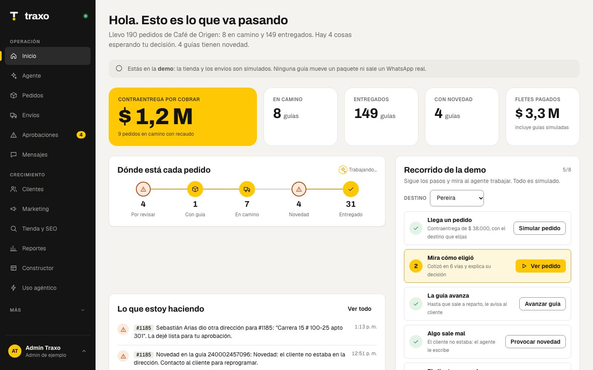<br><sub>Home</sub></td>
    <td width="50%">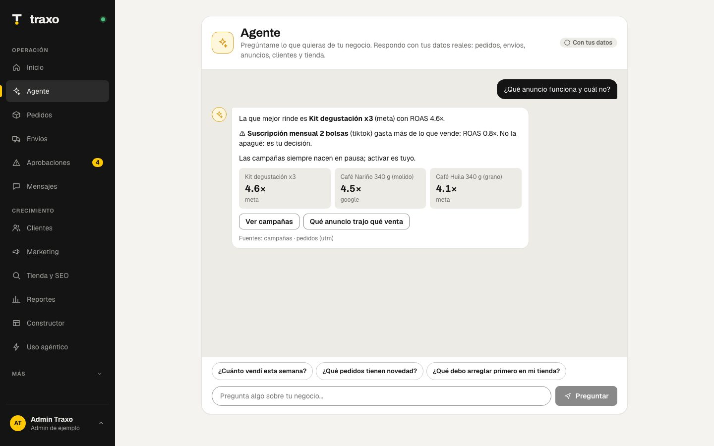<br><sub>Agent: chat with your business</sub></td>
  </tr>
  <tr>
    <td width="50%">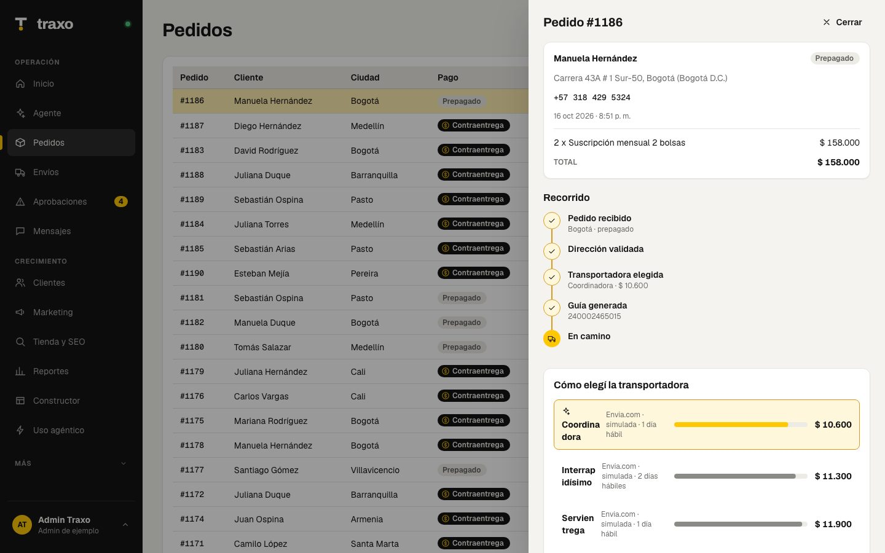<br><sub>Order detail and carrier choice</sub></td>
    <td width="50%">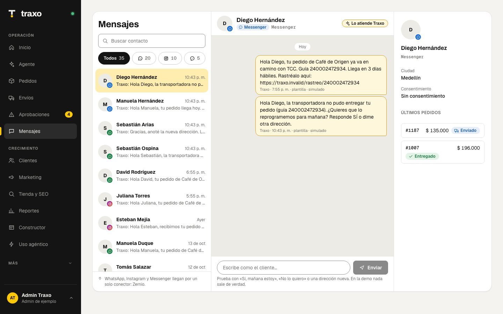<br><sub>Messages: WhatsApp, Instagram, Messenger</sub></td>
  </tr>
  <tr>
    <td width="50%">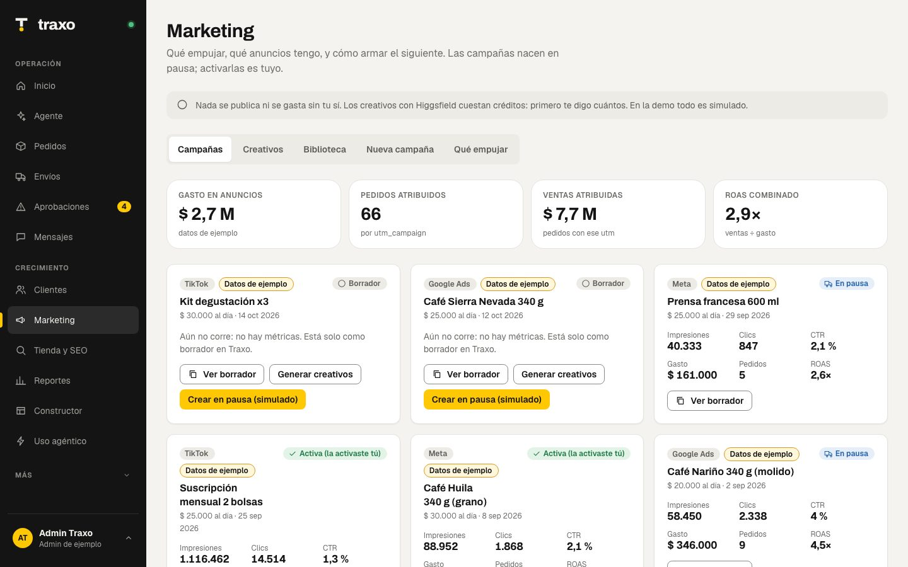<br><sub>Marketing: campaigns and real ROAS</sub></td>
    <td width="50%">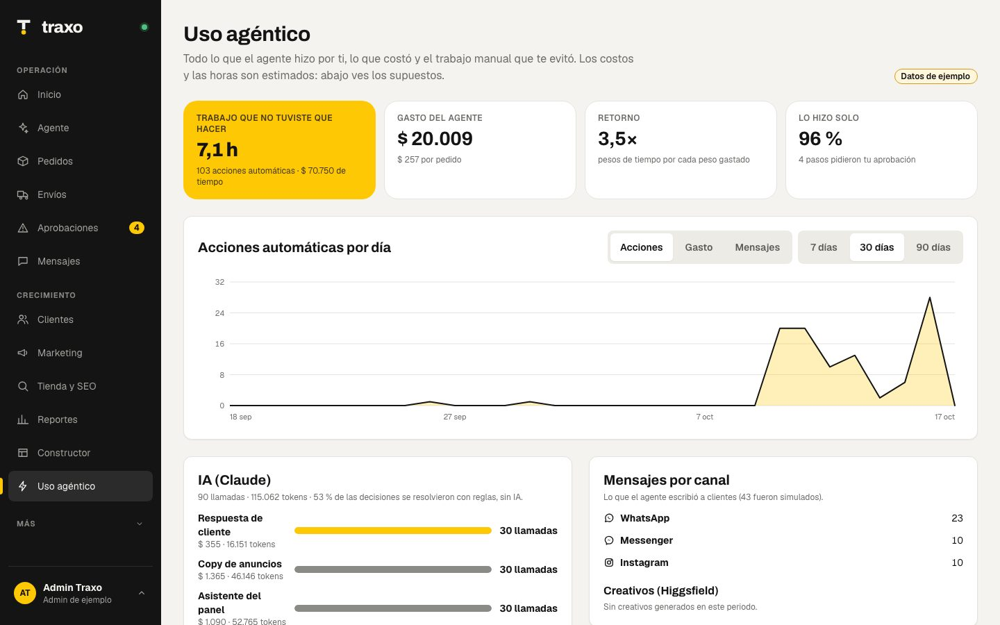<br><sub>Agent usage</sub></td>
  </tr>
  <tr>
    <td width="50%">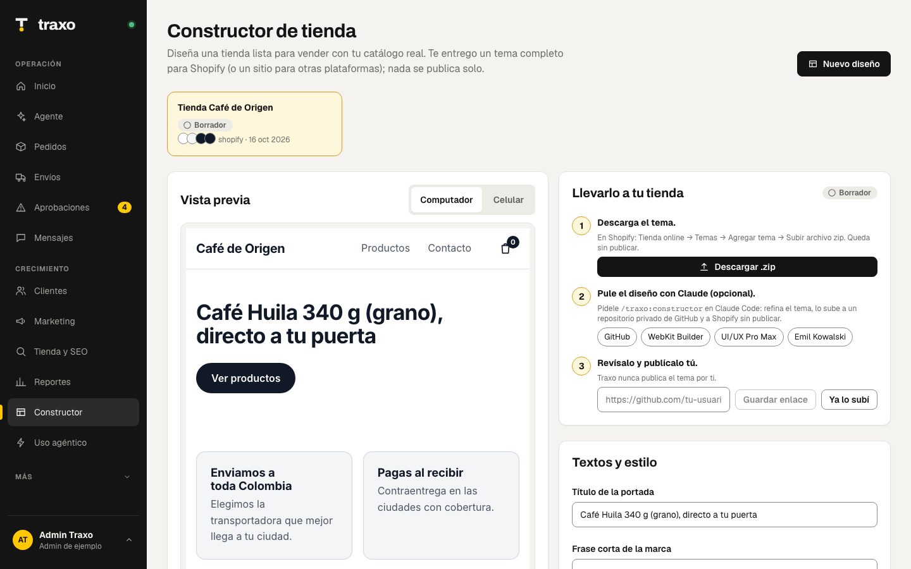<br><sub>Store builder: Shopify theme</sub></td>
    <td width="50%">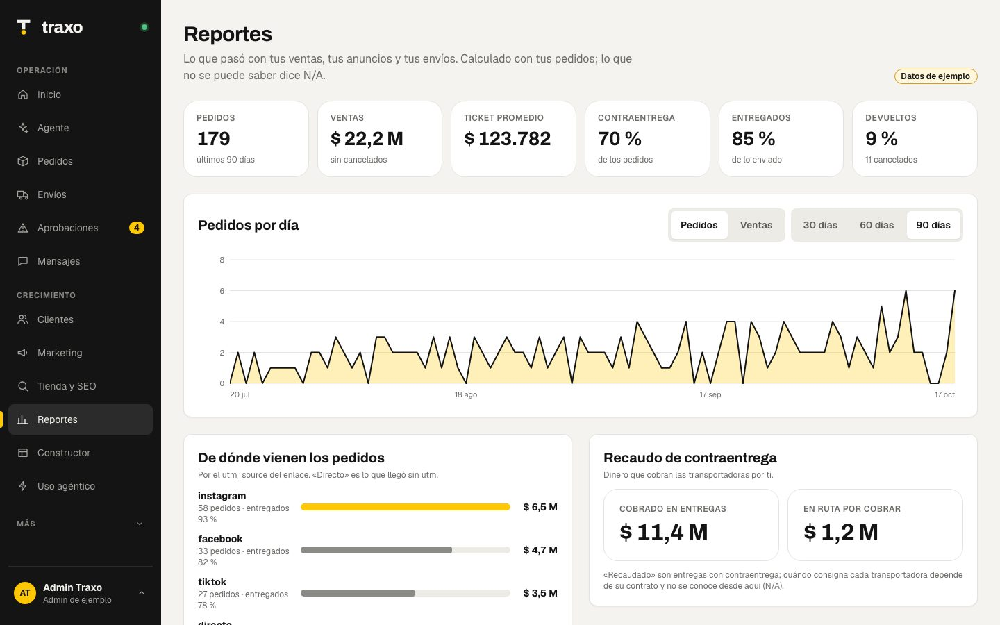<br><sub>Reports</sub></td>
  </tr>
</table>

<p align="center">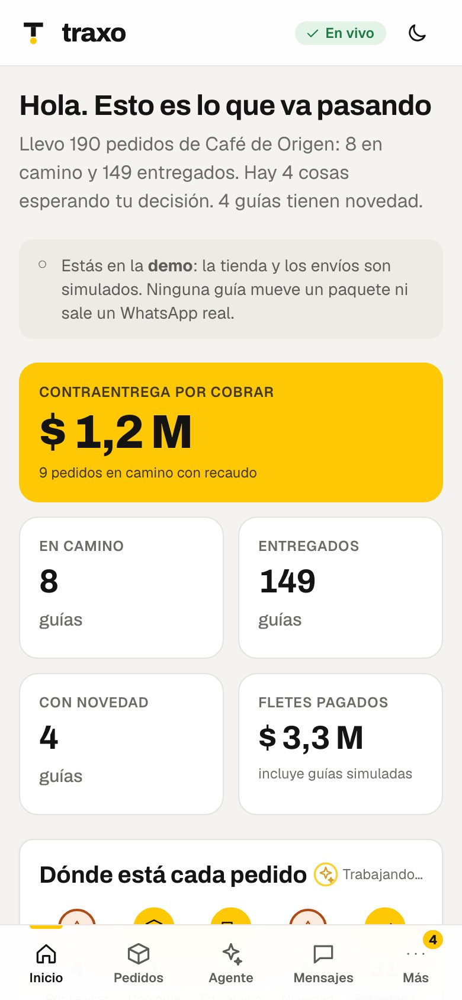 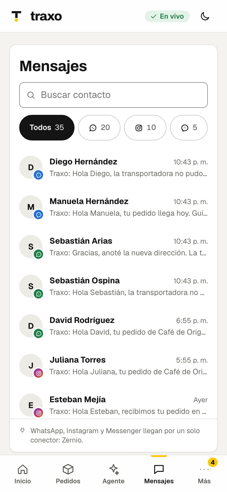</p>

## Install with the guided wizard

You need [Claude Code](https://claude.com/claude-code), [Node 24](https://nodejs.org) and [git](https://git-scm.com). The wizard does the rest.

```bash
claude plugin marketplace add Hainrixz/traxo-agente
claude plugin install traxo@traxo
```

Open `claude` and type:

```
/traxo:instalar
```

The wizard **asks you questions** and handles everything step by step, verifying each one:

1. Clones the project, installs dependencies and builds the panel.
2. Asks **where to run it** (your computer or a cloud like Railway), **which platform your store uses** (Shopify, Tiendanube, WooCommerce), **who you ship with**, your login email, your dispatch address and **what else to turn on** (WhatsApp/Instagram/Messenger through Zernio, prepayment with Wompi, AI with your own Claude key).
3. Creates your `.env` with the non-secret values, **generates the internal secrets for you** (sessions, `/mcp` token, admin password) and tells you **where to get each third-party key**. **You paste those into `.env` yourself: they never go through the chat or reach the model.**
4. Runs `pnpm doctor`, which checks everything (✓ / ✗ / –) and tests connections without ever printing a value.
5. Starts it locally, or deploys it to Railway (project, Postgres, variables, volume and domain) with your confirmation.
6. Gives you the **webhook** URLs for your store, Envia.com, Zernio and Wompi, connects Claude to Traxo's tools and leaves you ready for day one.

If something fails, the wizard explains it and fixes it before moving on. You can re-run `/traxo:instalar` any time: it never overwrites what you already configured. The wizard talks in Spanish today; English is on the [roadmap](docs/ROADMAP.md).

<details>
<summary>Manual install (without the wizard)</summary>

```bash
git clone https://github.com/Hainrixz/traxo-agente.git && cd traxo-agente
corepack enable && pnpm install
pnpm build
node scripts/setup.mjs --answers '{"adminEmail":"you@example.com","platform":"shopify","storeDomain":"yourstore.myshopify.com","envia":true}'
# open .env and paste your keys (the pending list is printed by the command above)
pnpm doctor           # checks that everything is fine
pnpm start            # http://localhost:8787  (sign in with the email and password in your .env)
claude mcp add --scope user traxo -- pnpm --silent --dir "$PWD" exec tsx apps/worker/src/mcp-stdio.ts
```

`node scripts/setup.mjs` (or `pnpm configurar`) and `pnpm doctor` never print a variable's value. Templates for every variable are in [`.env.example`](.env.example).
</details>

## What's in the panel

The left menu has what you use daily. What you configure lives in **your profile** (bottom left): settings, autonomy limits, connections, theme and sign out. The panel is in Spanish today; the translation layer is the first step of the [roadmap](docs/ROADMAP.md).

| Section | What it does |
|---|---|
| **Home** | How the day is going, where every order is, and what the agent did today |
| **Agent** | A chat with your business: "how much did I sell this week?", "which ad works and which doesn't?", "where is #1186?". Answers with your real data and sources, and never invents numbers (a missing figure shows as N/A) |
| **Orders** | Every order with its journey, how the carrier was chosen (cost with collection fee, days, reliability) and the label's timeline |
| **Shipments** | Carrier comparison using your own shipments, pickups and cancellation |
| **Approvals** | What the agent won't decide alone: doubtful address, label above your cap, unanswered cash on delivery |
| **Messages** | A chat-style inbox with contacts: **WhatsApp, Instagram and Messenger** in one place, with channel filter, search and customer card |
| **Customers** | Segments (repeat, new, inactive), audiences, consent-based messages, opt-out with "BAJA", export or delete data |
| **Marketing** | Campaigns with real ROAS, creatives, a **library of your UGC videos and product photos**, a campaign assistant (copy within each platform's limits) and what to push by margin |
| **Store & SEO** | SEO, AI-visibility and design audits. The score is computed **over the checks that could be measured** (N/A doesn't count) |
| **Reports** | Sales, which ad brought which sale, logistics per carrier and collections |
| **Builder** | Generates a **Shopify theme** (Online Store 2.0, accessible) from your real catalog, with desktop/phone preview, .zip download and a flow to a private GitHub repo and Shopify **without publishing** |
| **Agent usage** | What the agent did (actions, manual hours saved: estimated), what it cost (AI and credits) and messages per channel, with an optional budget |
| **More → Activity and Connections** | Everything the agent does, in order, and what is connected (store, carriers, Zernio, ads) |

## How tracking works

1. **An order arrives.** Traxo validates the address, scores the cash-on-delivery risk and quotes every route at once.
2. **It picks and explains:** the carrier with the best total cost (freight + collection fee), time and reliability. If the risk is high, **before spending on a label** it messages the customer: confirm, pay now with a discount, or change the address. No answer in 24 h and it comes to you.
3. **It creates the label** (if within your cap) and writes it to Shopify, Tiendanube or WooCommerce.
4. **It watches every parcel:** receives carrier events (webhook or polling), updates the timeline and tells the customer "arrives today, have $ X ready".
5. **It handles incidents:** if delivery fails it writes to the customer on their channel; "yes, I'm home tomorrow" reschedules by itself, a new address goes to Approvals.
6. **Everything is recorded:** Activity (what the agent did), Messages (what was said) and Orders (the journey). The panel's **Agent** summarizes it whenever you ask.

## Ads from your own UGC videos and photos

In **Marketing → Library** you upload your UGC videos and product photos (drag and drop; jpg, png, mp4, mov, up to 60 MB) or bring them from Higgsfield. When you build a campaign you pick from the library: **it costs no credits**. If something is missing, Traxo proposes the prompt and the credit cost, and **generates nothing until you confirm**. Campaigns are always born as drafts or paused.

From Claude, the `/traxo:campana` skill checks your library first (`listar_biblioteca`), uses what you already have as reference and records whatever is generated (`agregar_a_biblioteca`). Your files live on your server and are never published to any platform without your approval.

## Messaging and ads through one connector: Zernio

[Zernio](https://zernio.com) connects WhatsApp, Instagram, Messenger, Facebook and Google Ads / TikTok Ads accounts with a single key. In Traxo:

1. Create your Zernio account and connect your pages.
2. Set `ZERNIO_API_KEY` and `ZERNIO_WEBHOOK_SECRET` in your `.env` (or your cloud variables).
3. Point Zernio's webhook to `https://YOUR-DOMAIN/webhooks/messaging`.

Messages show up in **Messages** and the agent handles them. Traxo is also an MCP server, so from Claude you can use any other connector next to it (Meta Ads, Google Ads, TikTok) or any API.

## Use it inside Claude

With the plugin installed you get **12 skills** (`instalar`, `constructor`, `start`, `conectar`, `pedidos`, `envios`, `seguimiento`, `marketing`, `campana`, `clientes`, `tienda`, `reportes`), **4 agents** and an MCP server with **41 tools**. Tools that write, spend or delete require `confirm: true`; without it they return a draft. Ask anything: "audit my store", "which ad works", "build a campaign with my UGC videos", "design my store" (`/traxo:constructor`), "how much has the agent worked". Skill and tool names are in Spanish today.

## Optional AI with your own Claude key, and security

With `ANTHROPIC_API_KEY` in your `.env` or cloud variables, Traxo uses Claude in three places. **The key lives only on the server: it never reaches the browser or any response.**

| Where | What AI does | If it fails or no quota |
|---|---|---|
| **Agent** in the panel | Free-language answers that remember the conversation, with your real figures | Answers with rules over your data |
| **Customer replies** | Understands free text after an incident ("fine, drop it tomorrow"). Reschedules only at ≥ 80 % confidence; otherwise hands it to a person with a **draft reply that is never sent by itself** | A person sees it |
| **Campaigns** | "Improve copy with AI" rewrites titles and texts **within each platform's limits** | Your copy stays |

**Spend limits:** per store 6 requests per minute and 40 per day, and 500 per day per installation (`TRAXO_AI_PER_MIN`, `TRAXO_AI_PER_STORE_DAILY`, `TRAXO_AI_GLOBAL_DAILY`). `TRAXO_AI=off` turns it off. Third-party text (customers, web pages) is marked as data, never as instructions.

**What is exposed and how it is protected:** security headers everywhere; per-IP rate limit (`TRAXO_RATE_PER_MIN`); 1 MB body cap (60 MB only for file uploads); `/mcp` closed without `TRAXO_MCP_TOKEN` except from your own computer; signed webhooks; signed, per-store-isolated sessions; and a real store without `TRAXO_ADMIN_EMAIL`/`TRAXO_ADMIN_PASSWORD` only answers from your own computer. Report vulnerabilities privately: [`SECURITY.md`](SECURITY.md).

## Run it in the cloud

The wizard does it for you (`/traxo:instalar` → cloud). Railway is the documented target (Postgres included); any host that runs Node 24 and Postgres works. By hand:

**Railway dashboard**

1. On [railway.com](https://railway.com): **New Project → Deploy from GitHub repo** and pick your fork (`railway.json` already has the build and the `/health` healthcheck).
2. In the same project: **New → Database → PostgreSQL**.
3. In the app service → **Variables**: `DATABASE_URL` = `${{Postgres.DATABASE_URL}}`, plus the ones from your `.env` (`TRAXO_SESSION_SECRET`, `TRAXO_ADMIN_EMAIL`, `TRAXO_ADMIN_PASSWORD`, `TRAXO_MCP_TOKEN`, your store, carriers…).
4. **Settings → Networking → Generate Domain**. The panel, API, webhooks and `/mcp` all come from the same service.
5. To keep library videos and photos: a **Volume** mounted at `/data` and `TRAXO_MEDIA_DIR=/data/media`.

**Railway CLI**

```bash
npm i -g @railway/cli && railway login
railway init && railway add --database postgres
railway up
node scripts/railway-vars.mjs --service <your-service>   # pushes your .env without printing values
railway domain
```

Connect Claude to your cloud server:

```bash
claude mcp add --transport http traxo https://YOUR-DOMAIN/mcp --header "Authorization: Bearer $TRAXO_MCP_TOKEN"
```

### Webhooks (so Traxo hears things live)

| From | Address | Event |
|---|---|---|
| Your store | `https://YOUR-DOMAIN/webhooks/commerce/shopify` (or `tiendanube`, `woocommerce`) | Order created |
| Envia.com | `https://YOUR-DOMAIN/webhooks/carriers/envia-com` | Tracking |
| Zernio | `https://YOUR-DOMAIN/webhooks/messaging` | Incoming messages |
| Wompi | `https://YOUR-DOMAIN/webhooks/payments/wompi` | Transaction updated |

## Environment variables

| Variable | Purpose |
|---|---|
| `TRAXO_ADMIN_EMAIL` / `TRAXO_ADMIN_PASSWORD` | Account that signs in to the panel |
| `TRAXO_SESSION_SECRET` | Session signing (pin it in the cloud) |
| `TRAXO_MCP_TOKEN` / `TRAXO_API_TOKEN` | Protect `/mcp` and the API for scripts |
| `TRAXO_STORE_NAME` / `TRAXO_STORE_URL` | Your store's name and URL |
| `DATABASE_URL` | Postgres. Empty = local PGlite in `.traxo-data/pg` |
| `SHOPIFY_*`, `TIENDANUBE_*`, `WOOCOMMERCE_*` | Store |
| `ENVIA_TOKEN`, `ENVIA_ENV`, `ENVIA_WEBHOOK_SECRET` | Envia.com (quotes, labels, tracking) |
| `ZERNIO_API_KEY`, `ZERNIO_WEBHOOK_SECRET` | WhatsApp, Instagram, Messenger and ads |
| `WOMPI_PRIVATE_KEY`, `WOMPI_ENV`, `WOMPI_EVENTS_SECRET` | Payment link for cash-on-delivery prepayment |
| `ORIGIN_*` | Origin address of your shipments |
| `ANTHROPIC_API_KEY`, `TRAXO_AGENT_MODEL` | Optional: AI for the agent, customer replies and campaign copy |
| `TRAXO_AI`, `TRAXO_AI_PER_MIN`, `TRAXO_AI_PER_STORE_DAILY`, `TRAXO_AI_GLOBAL_DAILY` | AI spend limits |
| `TRAXO_AI_USD_PER_MTOK_IN`, `TRAXO_AI_USD_PER_MTOK_OUT`, `TRAXO_USD_PER_CREDIT`, `TRAXO_USD_COP`, `TRAXO_HOUR_COP`, `TRAXO_AI_BUDGET_USD_MONTH` | Estimates for the Agent usage panel: AI prices, credits, exchange rate, value of an hour and optional monthly budget |
| `TRAXO_RATE_PER_MIN` | Requests per minute per IP |
| `TRAXO_MEDIA_DIR` | Where library files are stored |
| `TRAXO_AUDIT_LIVE=1` | Allows auditing real public URLs |
| `TRAXO_DEMO=1` | **Testing only**: sample data and open sign-up ([`docs/modo-demo.md`](docs/modo-demo.md)). Never use with real data |

What still needs testing against real services is in [`docs/credenciales-pendientes.md`](docs/credenciales-pendientes.md).

## Supported markets

| Market | Status | What it includes |
|---|---|---|
| 🇨🇴 **Colombia** | Supported (first market) | COP, DANE city codes, +57 phones, Ley 1581 consent, cash on delivery, Envia.com carriers (Coordinadora, Servientrega, Interrapidísimo, TCC…), Wompi |
| 🌎 **More countries** | [Planned](docs/ROADMAP.md) | Mexico is the natural next one (same language; Envia.com already ships there) |

The market-specific pieces (currency, phone format, address model, privacy law, carriers, payments) are being isolated behind a `Market` interface so adding a country means adding a package, not rewriting the agent. The plan and how to contribute a market are in [`docs/mercados.md`](docs/mercados.md) and [`docs/ROADMAP.md`](docs/ROADMAP.md).

## What works today and what needs your credentials

**Works without credentials:** the order pipeline, the Builder (generates the Shopify theme), the Agent usage panel, carrier selection, cash-on-delivery confirmation with prepayment, tracking and incidents, approvals, the panel agent, the messages inbox, the creative library, the campaign assistant, audiences, audits (with SSRF protection), reports, the plugin and the MCP server.

**Code exists but is untested against the real service** (needs your credentials): Shopify, Tiendanube, WooCommerce, Envia.com (sandbox), Zernio and Wompi.

**No real adapter yet:** 99envios (no public docs) and direct Coordinadora, Servientrega, Interrapidísimo and Envía (they require a contract). They run simulated; details in [`docs/integraciones/`](docs/integraciones/).

**Done from Claude:** creating real Meta campaigns (paused and verified), uploading audiences and generating creatives with Higgsfield (costs credits: quoted and confirmed first).

## Architecture

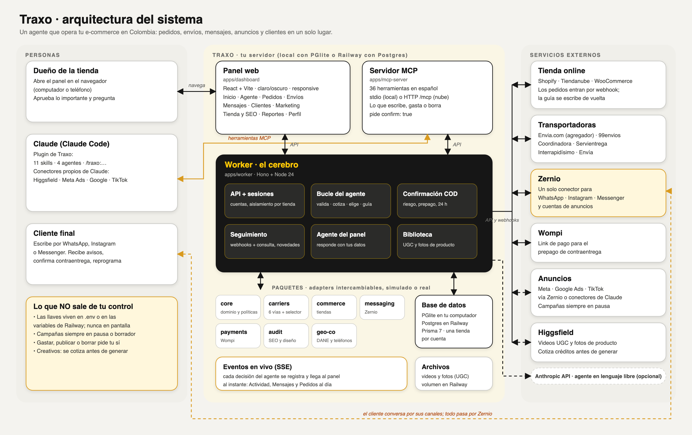

Vector version: [`docs/arquitectura.svg`](docs/arquitectura.svg).

## Structure

```
.claude-plugin/ skills/ agents/             Claude Code plugin (includes the /traxo:instalar wizard)
scripts/                                    setup, doctor and railway-vars (never print secrets)
apps/worker        API, sessions, webhooks, panel agent, tracking, /mcp  (Hono)
apps/mcp-server    MCP tools
apps/dashboard     Panel (Vite + React)
packages/          core · db (Prisma 7) · commerce · carriers · messaging · payments · audit · storefront · geo-co
docs/              integrations, pending credentials, architecture, markets, roadmap
```

Development: `pnpm test` · `pnpm lint` · `pnpm typecheck` · `pnpm dev` (API) and `pnpm dev:ui` (panel with reload).

## Contributing, security and license

- [`CONTRIBUTING.md`](CONTRIBUTING.md): dev environment and rules. [`CODE_OF_CONDUCT.md`](CODE_OF_CONDUCT.md).
- Vulnerabilities: [`SECURITY.md`](SECURITY.md) (privately, not in a public issue).
- Changes: [`CHANGELOG.md`](CHANGELOG.md). Demo mode and sample data: [`docs/modo-demo.md`](docs/modo-demo.md).
- Where it's going: [`docs/ROADMAP.md`](docs/ROADMAP.md). Adding a country: [`docs/mercados.md`](docs/mercados.md).
- [MIT](LICENSE) license.
